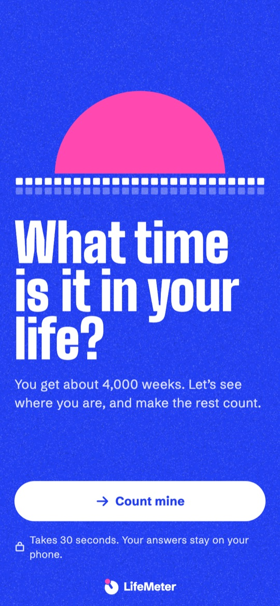
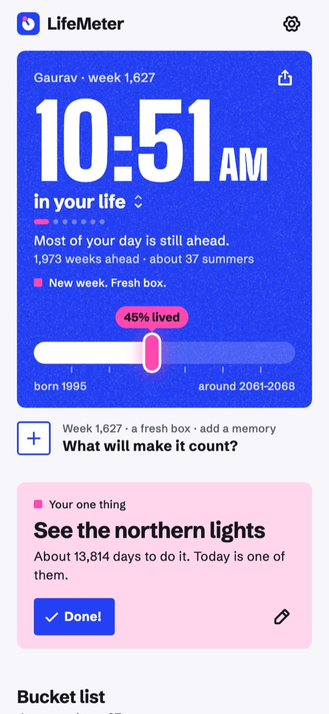
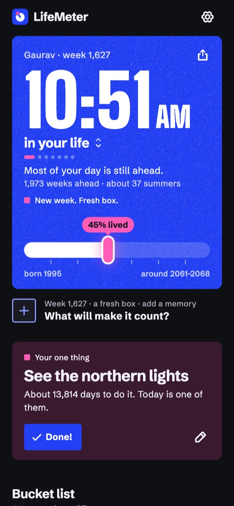
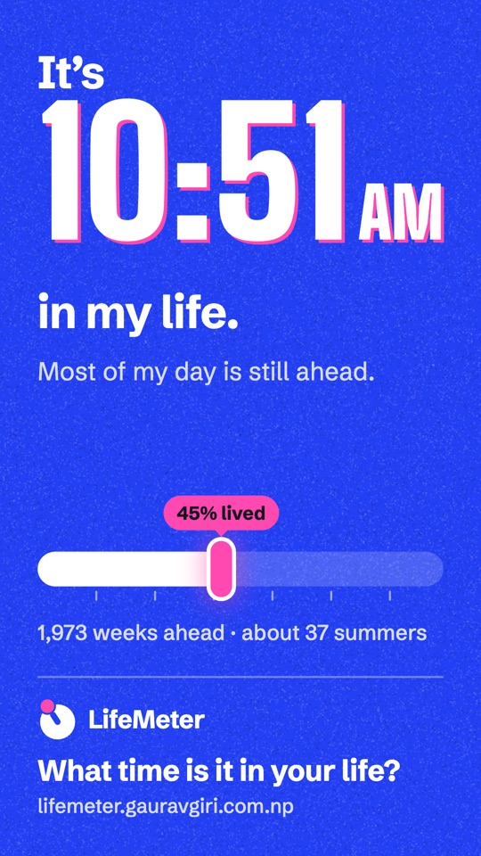
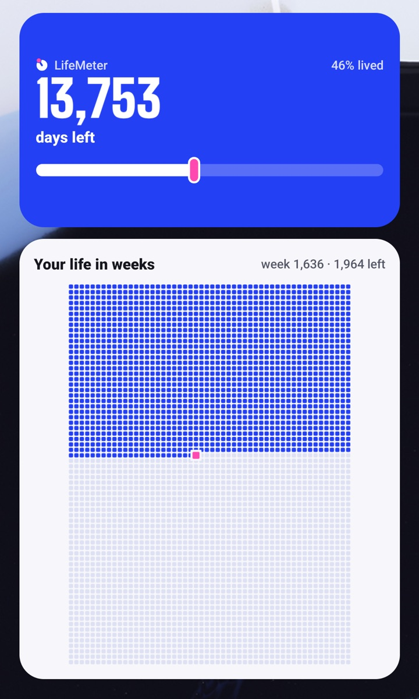
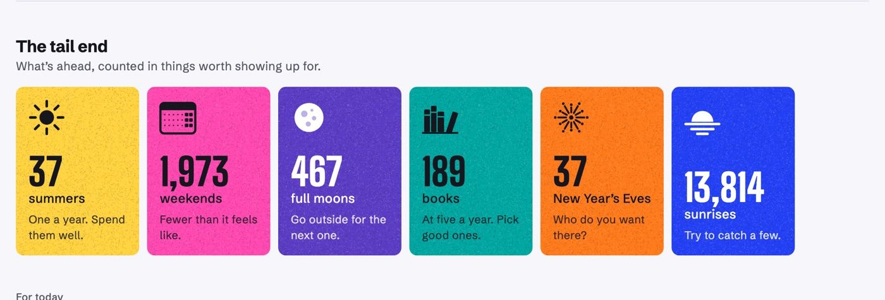
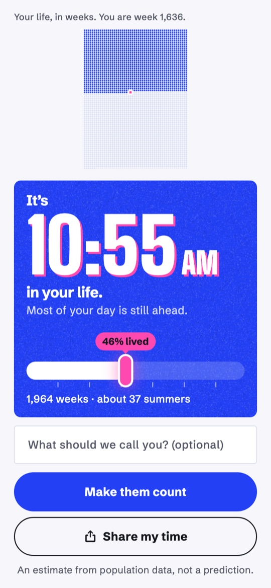
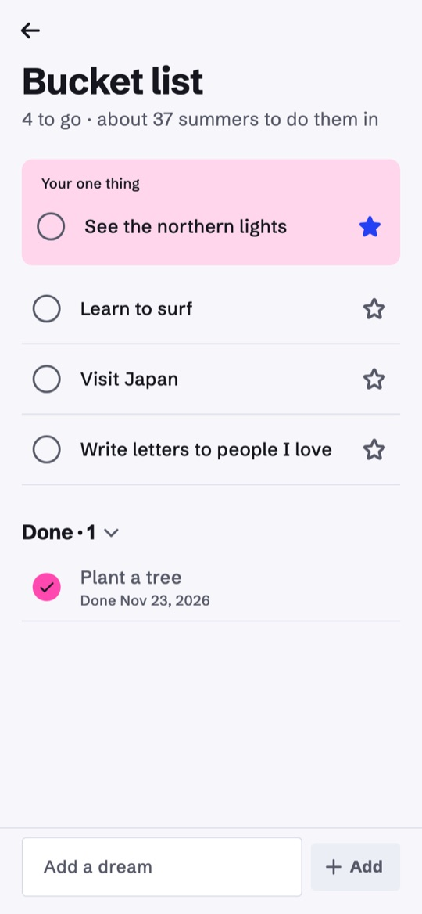

# LifeMeter

**What time is it in your life?**

LifeMeter maps your life onto a single day. If you've lived 45% of the years you can expect, it's **10:54 AM in your life**, and most of your day is still ahead. It counts the time you have left in weeks, days, summers and the moments that matter, so you spend them on purpose.

**Website:** [lifemeter.gauravgiri.com.np](https://lifemeter.gauravgiri.com.np) · [How it works](https://lifemeter.gauravgiri.com.np/how-it-works/) · [Privacy](https://lifemeter.gauravgiri.com.np/privacy/) ([PRIVACY.md](PRIVACY.md)) · [Terms](https://lifemeter.gauravgiri.com.np/terms/) · [Help](https://lifemeter.gauravgiri.com.np/support/)

<div align="center">
  
  
  
  
</div>

<p align="center">
  
</p>

## Features

- **Life Clock.** Your life mapped onto a 24-hour day: "It's 10:54 AM in your life."
- **Time slideshow.** The home screen rotates through Life Clock, weeks, days, hours, live seconds, summers and % lived. Tap to skip, or turn it off in Settings.
- **Life progress bar.** A bold bar of life lived, with a glowing "now" marker, a "% lived" badge and a tick for every decade.
- **Your one thing.** The one thing you most want to do, beside your count. Mark it done and pick the next.
- **Bucket list.** Everything else you want to do. Tick items off, swipe to delete (with undo), or pin one as your one thing.
- **Life in weeks.** Every week of your life as a square, one row per year. Add a short memory to any week and it turns pink.
- **The tail end.** What's ahead in moments: summers, weekends, full moons, books, New Year's Eves and sunrises, each on its own illustrated card.
- **Your people.** "About 50 more visits with Mum", from their age and how often you see them.
- **Milestones.** For example "12,500 days old in 41 days", each with a share card.
- **Share cards.** One tap makes a 9:16 image for stories: your Life Clock, life in weeks, a milestone or a person.
- **Lock-screen wallpaper.** Sets your life grid and Life Clock as the lock screen.
- **Android widgets.**
  - **Countdown:** a slideshow of Life Clock, years, weeks, days, hours and a live seconds countdown, or one unit of your choice. Includes the progress bar and your one thing.
  - **Life in weeks:** the whole grid, with this week marked.
  - **Life Clock:** the time in your life.

  The widgets resize down to two cells wide, so they fit side by side. They update on their own and follow light and dark mode.
- **Quote of the day.** From [ZenQuotes](https://zenquotes.io/), fetched once a day; offline, a public-domain line about time.
- **Quick onboarding.** About 30 seconds: birthday, country, sex, then the reveal. Your name and five optional health questions come after.
- **Private.** No account, no servers, no ads and no tracking. Your answers stay on your device; the only network request is the daily quote.

<p align="center">
  
</p>

<div align="center">
  
  
</div>

## How the estimate works

1. **Baseline:** life expectancy at birth for your country and sex, for 217 countries and territories (2024). The figures come from the World Bank's [World Development Indicators](https://data.worldbank.org/indicator/SP.DYN.LE00.IN) (`SP.DYN.LE00.FE.IN`, `SP.DYN.LE00.MA.IN`), which take them from the UN's [World Population Prospects](https://population.un.org/wpp/); licence CC BY 4.0. [`lib/data/countries.dart`](lib/data/countries.dart) is generated; refresh it with:

   ```sh
   dart run tool/update_life_expectancy.dart
   ```

2. **Optional adjustments** for five habits with strong evidence, capped to a plausible range. See [`lib/data/lifestyle.dart`](lib/data/lifestyle.dart).

   | Habit | Source |
   |---|---|
   | Smoking | Jha et al., NEJM 2013 |
   | Physical activity | Moore et al., PLOS Medicine 2012 |
   | Alcohol | Wood et al., The Lancet 2018 |
   | Body weight | Prospective Studies Collaboration, The Lancet 2009 |
   | Diet | Fadnes et al., PLOS Medicine 2022 |

The app shows the result as a range ("around 2060–2067"), never a single date. It's a population estimate, not a prediction and not medical advice, and the app says so wherever the number appears.

## Design

The look is "Riso Morning", styled after two-colour risograph prints: Riso cobalt and fluorescent pink on cool paper, with a little print grain.

- **Pink means now:** the logo's heart, this week, and the progress marker.
- **Logo:** the Life Clock with one hand at 10:54, pointing to a pink heart: now, spent on what you love. Most of the day is still ahead. `tool/logo.py` generates every logo file.
- **Fonts:** [Big Shoulders Display](https://fonts.google.com/specimen/Big+Shoulders) for numbers, [Schibsted Grotesk](https://fonts.google.com/specimen/Schibsted+Grotesk) for text. Both are under the SIL Open Font License; the licence files are in `assets/fonts`.
- **Icons:** [Phosphor](https://phosphoricons.com/) (MIT).
- **Themes:** light by default; dark follows the system.

The design tokens live in [`lib/theme/theme.dart`](lib/theme/theme.dart). The widgets mirror them in `android/app/src/main/res/values*/lifemeter*.xml`.

To review the UI without a device, render every key screen, light and dark, to `build/screens/`:

```sh
flutter test test/screenshots/render_screens_test.dart --dart-define=RENDER=true
```

## Development

Requires Flutter 3.44 or later (see `.fvmrc`).

```sh
flutter pub get
flutter test
flutter run
```

Regenerate the logo files and launcher icons after changing the mark in `tool/logo.py`:

```sh
python3 tool/logo.py
dart run flutter_launcher_icons
```

The Android widgets are in `android/app/src/main/kotlin/com/example/lifemeter/`: `LifeWidgetProvider.kt` (countdown), `LifeWeeksWidgetProvider.kt` (life in weeks), `LifeClockWidgetProvider.kt`, and shared drawing in `WidgetArt.kt`. The app pushes only the birth and estimated-end timestamps, your one thing and the chosen unit through [`home_widget`](https://pub.dev/packages/home_widget). The widgets compute everything else themselves, so they stay current without the app open.

## Website

The pages at [lifemeter.gauravgiri.com.np](https://lifemeter.gauravgiri.com.np) (home, how it works, privacy policy, terms and help) are plain static files in [`site/`](site/), with a `CNAME` for GitHub Pages. Each page is a folder, so `/privacy` works on any static host. The app links to them from Settings, and share cards and share text carry the address. The app's URLs live in [`lib/data/site.dart`](lib/data/site.dart).

## Credits

- Life expectancy data: World Bank WDI / UN World Population Prospects (CC BY 4.0).
- Inspirational quotes provided by [ZenQuotes API](https://zenquotes.io/).
- Fonts: Big Shoulders Display and Schibsted Grotesk (SIL OFL). Icons: Phosphor (MIT).

## License

[MIT](LICENSE)

## Contact

For support and feedback, please contact Gaurav Giri at gaurovgiri@gmail.com.
